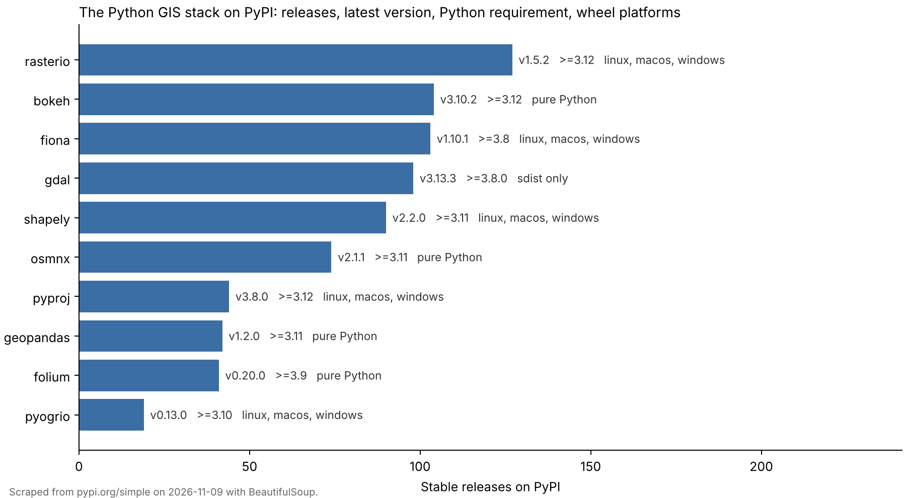

# GIS Package Tracker (BeautifulSoup web scraping)

A web scraper that checks the health of the Python GIS stack. For each package (GeoPandas, Shapely, pyproj, Fiona, pyogrio, Rasterio, GDAL, Folium, OSMnx, Bokeh) it scrapes the package's [PyPI simple index](https://pypi.org/simple/geopandas/) page with BeautifulSoup and reports:

- how many stable releases it has
- the latest stable version (skipping yanked and pre-release uploads)
- the Python version that release requires
- which operating systems get prebuilt wheels, or whether it's pure Python or source-only



One practical finding: **GDAL is the only package here with no wheels on PyPI**, so `pip install gdal` has to compile against a system GDAL library. That's why most people install it through conda, or use Fiona, pyogrio, or Rasterio, which ship GDAL inside their wheels.

## How it works

1. Requests each page from `https://pypi.org/simple/<package>/` with a descriptive User-Agent and a one-second pause between requests.
2. Parses every `<a>` tag with BeautifulSoup. Each link is one uploaded file, and its attributes carry metadata (`data-requires-python`, `data-yanked`).
3. Interprets wheel and source filenames with `packaging` to get versions and platform tags (Windows, macOS, Linux, or pure Python).
4. Writes `outputs/files.csv` (every file record), `outputs/summary.csv` (one row per package), and `outputs/summary.png`.

## Run it

```bash
pip install -r requirements.txt
python gis_package_tracker.py                     # default GIS package list
python gis_package_tracker.py geopandas shapely   # any PyPI packages you like
pytest -q                                         # offline parser tests
```

## Skills demonstrated

- HTML parsing with BeautifulSoup, including reading data attributes and handling escaped characters
- Polite scraping: identifying User-Agent, rate limiting, and error handling for bad package names
- Structured output to CSV and a Matplotlib summary chart
- Unit tests on a fixed HTML sample, so the parser is tested without hitting the network, and automated with GitHub Actions

The original version of this repo was a short course exercise that summed comment counts on a single page. This version keeps the BeautifulSoup core and applies it to a real question about the GIS tools I use.
